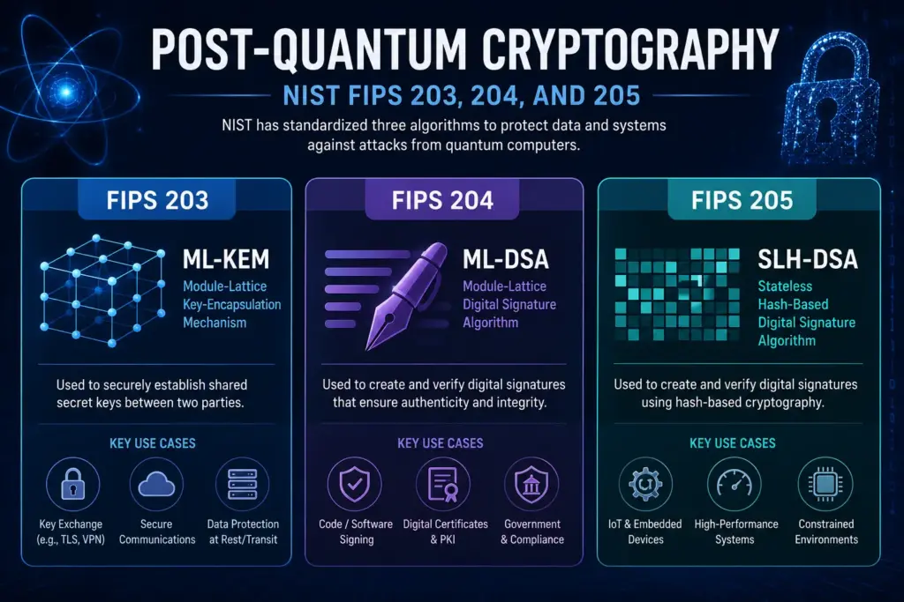
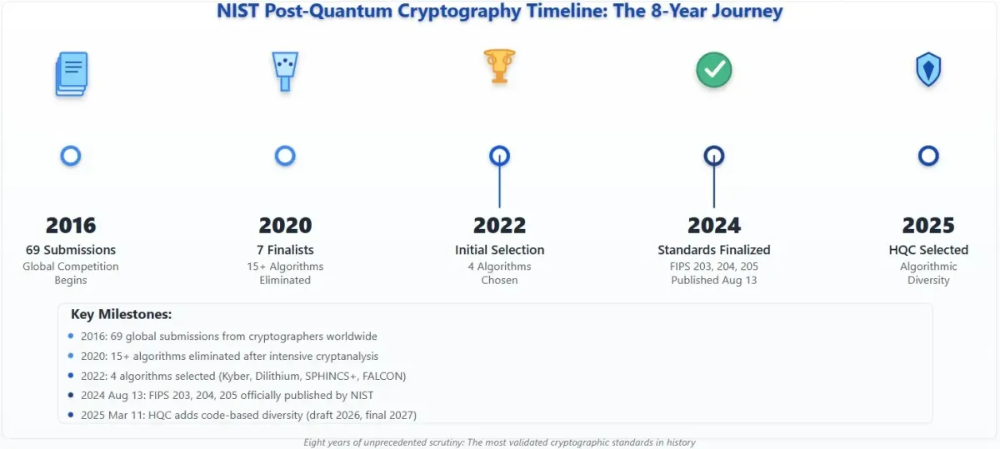
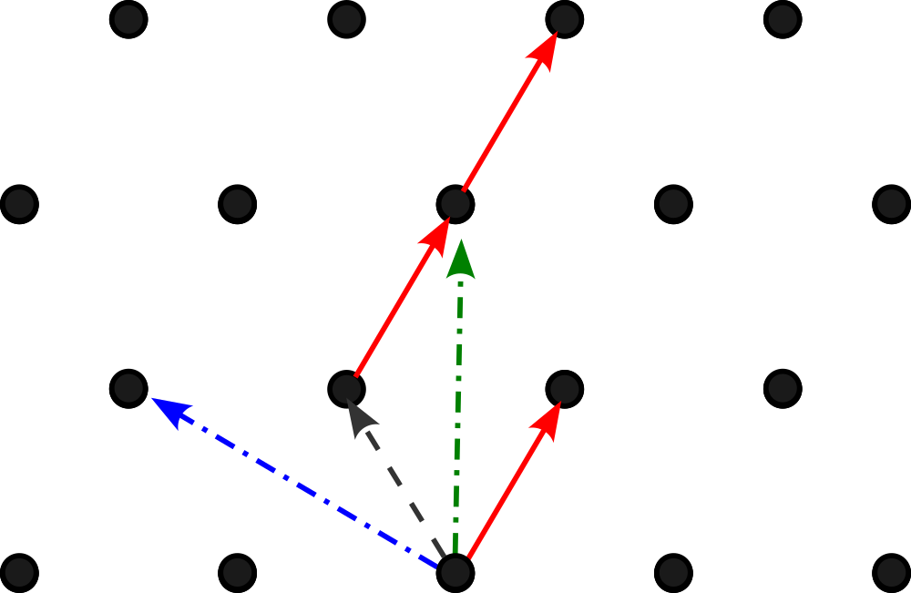
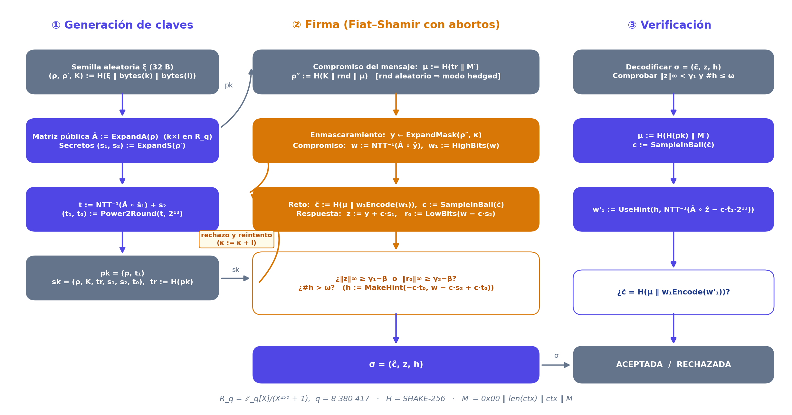
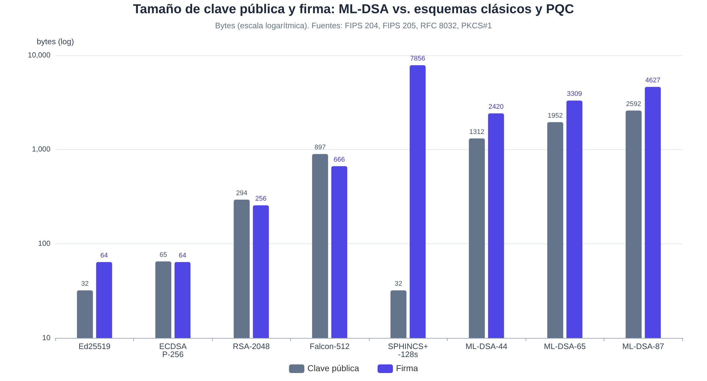
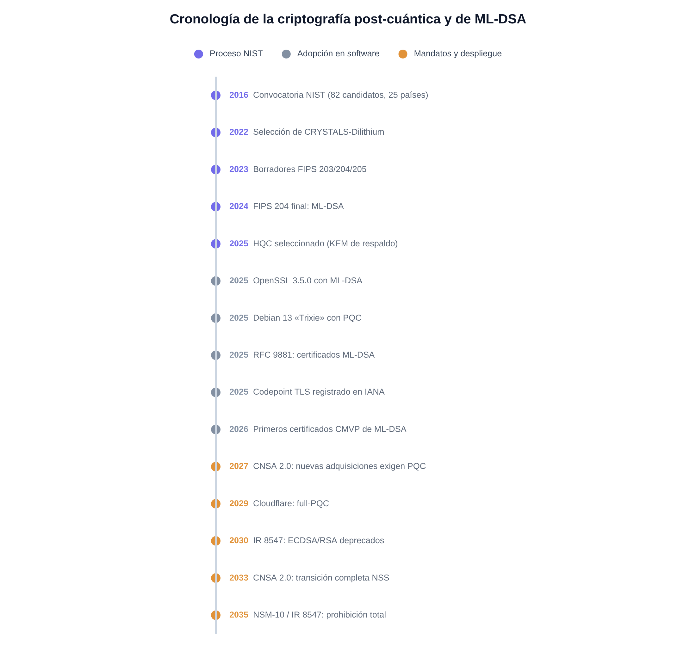
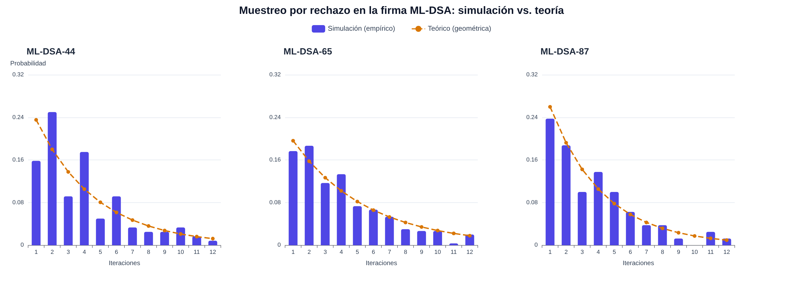

# Criptografía post-cuántica: ML-DSA (FIPS 204)

**Informe técnico para exposición académica** — Estándar de firma digital basado en retículos del NIST, con fundamentos matemáticos, análisis de seguridad, comparativas de rendimiento y una simulación propia validada con vectores oficiales.

---

## Resumen ejecutivo

**ML-DSA** (*Module-Lattice-Based Digital Signature Algorithm*) es el estándar de firma digital post-cuántica publicado por el NIST como **FIPS 204** el 13 de agosto de 2024, y constituye la versión estandarizada del esquema CRYSTALS-Dilithium seleccionado en julio de 2022 tras seis años de competición pública internacional ([NIST](https://www.nist.gov/news-events/news/2024/08/nist-releases-first-3-finalized-post-quantum-encryption-standards), [FIPS 204](https://nvlpubs.nist.gov/nistpubs/FIPS/NIST.FIPS.204.pdf)). Su seguridad descansa en la dificultad de los problemas **Module-LWE** y **Module-SIS** sobre retículos algebraicos estructurados, para los que no se conoce ningún algoritmo —ni clásico ni cuántico— que los resuelva eficientemente, en contraste con RSA y la criptografía de curva elíptica, que caen ante el algoritmo de Shor en cuanto exista un ordenador cuántico criptográficamente relevante. El estándar define tres conjuntos de parámetros —**ML-DSA-44, ML-DSA-65 y ML-DSA-87**, asociados a las categorías de seguridad 2, 3 y 5 del NIST— con firmas de 2 420, 3 309 y 4 627 bytes respectivamente, un rendimiento que rivaliza con Ed25519 en verificación, y un diseño basado en la técnica *Fiat–Shamir con abortos* que evita los muestreos gaussianos difíciles de proteger frente a canales laterales.

Como parte práctica de este trabajo se ha desarrollado una **implementación educativa completa de FIPS 204 en Python puro** (`simulacion/mldsa_puro.py`), validada contra los **525 vectores oficiales ACVP del NIST** (generación de claves, firma y verificación, incluidos los modos determinista, *hedged*, pre-hash y *ExternalMu*), y se han ejecutado sobre ella cuatro experimentos: medición empírica del bucle de muestreo por rechazo frente a la distribución geométrica teórica, pruebas de rechazo de firmas alteradas (un solo bit modificado, mensaje distinto, clave pública ajena o contexto distinto), reproducibilidad del modo determinista frente al *hedged*, y medición de tiempos. Las cifras de adopción confirman que ML-DSA ya es infraestructura real: OpenSSL 3.5 lo incorpora desde abril de 2025, Debian 13 «Trixie» lo distribuye de serie desde agosto de 2025, el RFC 9881 define su uso en certificados X.509 desde octubre de 2025, y la directiva estadounidense CNSA 2.0 lo exige —en su variante ML-DSA-87— para los sistemas de seguridad nacional, con una retirada planificada de la criptografía clásica entre 2030 y 2035.

---

## 1. La amenaza cuántica: por qué hace falta ML-DSA

### 1.1 El algoritmo de Shor y el fin de la criptografía de clave pública actual

Toda la seguridad de Internet —TLS, certificados, firmas de software, banca electrónica— se apoya en dos familias de problemas matemáticos: la **factorización de enteros grandes** (RSA) y el **logaritmo discreto** en grupos finitos o en curvas elípticas (DH, ECDH, DSA, ECDSA, EdDSA). En 1994, Peter Shor demostró que un ordenador cuántico suficientemente grande resuelve ambos problemas en tiempo polinómico, concretamente en *O((log N)²·log log N·log log log N)* operaciones para factorizar un entero N, lo que reduce un problema exponencial a uno manejable ([Shor](https://arxiv.org/abs/quant-ph/9508027)). Esto significa que, a diferencia de un ataque de fuerza bruta —que solo se mitiga aumentando el tamaño de la clave—, el algoritmo de Shor **rompe estructuralmente** cualquier tamaño de clave RSA o ECC: no hay parámetro «grande» que salve a estos esquemas de un adversario cuántico suficientemente potente.

La pregunta práctica es cuántos qubits físicos harían falta. En 2019, Gidney y Ekerå estimaron que factorizar RSA-2048 en ocho horas requeriría unos **20 millones de qubits ruidosos** asumiendo corrección de errores con códigos de superficie ([Quantum Journal](https://quantum-journal.org/papers/q-2021-04-15-433/)). Apenas seis años después, en mayo de 2025, el propio Gidney (Google Quantum AI) rebajó esa estimación en más de un factor 20 —a **menos de un millón de qubits ruidosos** y menos de una semana de cómputo— gracias a mejoras algorítmicas (periodo al estilo Ekerå–Håstad, ventanas de multiplicación, almacenamiento «yoked») y no a ningún avance de hardware ([Google Research](https://research.google/pubs/how-to-factor-2048-bit-rsa-integers-with-less-than-a-million-noisy-qubits/), [arXiv](https://arxiv.org/abs/2505.15917)). La lección para el planificador de seguridad es inquietante: **el coste del ataque baja por mejoras matemáticas aunque el hardware avance despacio**, y cada publicación reciente ha ido en la dirección de abaratarlo. Un preprint de febrero de 2026 llegó incluso a estimar por debajo de los 100 000 qubits físicos, evidencia de que la frontera sigue moviéndose.

### 1.2 «Harvest now, decrypt later» y el teorema de Mosca

Incluso si el ordenador cuántico capaz de romper RSA llegara dentro de quince años, el problema es **actual** por la estrategia conocida como *harvest now, decrypt later* («cosechar ahora, descifrar después»): un adversario puede interceptar y almacenar hoy tráfico cifrado —secretos de Estado, historiales médicos, propiedad industrial— y descifrarlo cuando disponga de la máquina. Para las firmas digitales la simetría del ataque es distinta pero igual de grave: lo que está en juego es la **falsificación futura** de credenciales, actualizaciones de firmware, certificados raíz y transacciones, muchas de las cuales tienen vigencias de décadas (una credencial verificable emitida hoy con validez de diez años seguirá verificándose en plena era cuántica).

Michele Mosca formalizó este razonamiento en lo que se conoce como **teorema o desigualdad de Mosca**: si *x* es el número de años que los datos deben permanecer seguros, *y* los años que tardará la organización en migrar su infraestructura, y *z* los años hasta que exista un ordenador cuántico criptográficamente relevante, entonces si **x + y > z** la organización ya va tarde: la información estará expuesta durante x + y − z años ([Mosca, ePrint 2015/1075](https://eprint.iacr.org/2015/1075)). Dado que las migraciones criptográficas profundas tardan típicamente entre una y dos décadas (la transición de MD5/SHA-1 o de RSA-1024 a RSA-2048 así lo demostró), y que los datos sensibles suelen necesitar entre 10 y 30 años de confidencialidad, la desigualdad se cumple holgadamente para casi cualquier estimación razonable de *z*. Este argumento —no la fecha concreta del «Q-day»— es el motor de los mandatos gubernamentales que se analizan en la sección 7.

### 1.3 ¿Cuándo llegará un ordenador cuántico criptográficamente relevante?

La referencia más citada para estimar *z* es el *Quantum Threat Timeline Report* del Global Risk Institute y evolutionQ, una encuesta anual a expertos en computación cuántica que se publica desde 2019. La séptima edición, fechada en marzo de 2026 y basada en 26 expertos internacionales, sitúa la probabilidad media de que exista un ordenador cuántico capaz de factorizar RSA-2048 en menos de 24 horas —un *CRQC*, *cryptographically relevant quantum computer*— entre el **28 % y el 49 % a diez años vista**, la cifra más alta de la historia del informe; a quince años la horquilla sube al 51-70 %, y a veinte años el 92 % de los encuestados la sitúa en el 50 % o más ([Global Risk Institute](https://globalriskinstitute.org/publication/quantum-threat-timeline-report-2025b/)). Ediciones anteriores ya apuntaban a una compresión de los plazos, y los autores atribuyen el salto a los avances recientes en corrección de errores cuánticos y qubits lógicos.

Conviene leer estas cifras con dos matices. El primero es que se trata de una **encuesta de opinión experta**, no de una predicción física: los 26 encuestados no pueden anticipar ni los avances algorítmicos sorpresa (como el propio factor 20 de Gidney en 2025) ni los programas clasificados de los Estados. El segundo es que, para la gestión de riesgo, la probabilidad concreta importa menos que su asimetría: una probabilidad del 30 % de un evento catastrófico para toda la PKI mundial es más que suficiente para justificar una migración cuyo coste, aunque elevado, es finito y planificable. Es exactamente el razonamiento que aplican el NIST, la NSA y la Unión Europea al fijar fechas límite entre 2030 y 2035, como se detalla en la sección 7.

---

## 2. El proceso de estandarización del NIST y el nacimiento de ML-DSA

### 2.1 La competición PQC (2016-2024)

Anticipándose a la amenaza, el NIST anunció en diciembre de 2016 una convocatoria pública para diseñar, evaluar y estandarizar algoritmos de criptografía post-cuántica, a imagen y semejanza de los concursos que produjeron AES (1997-2000) y SHA-3 ([NIST](https://www.nist.gov/news-events/news/2016/12/nist-asks-public-help-future-proof-electronic-information)). Se recibieron **82 candidatos de 25 países**, de los cuales 69 fueron admitidos a la primera ronda; el proceso se prolongó durante tres rondas y ocho años, con talleres públicos, miles de mensajes en el foro pqc-forum y un esfuerzo de criptoanálisis global sin precedentes ([NIST PQC](https://csrc.nist.gov/projects/post-quantum-cryptography)). El propio proceso demostró su valor como filtro de seguridad: candidatos tan prometedores como SIKE —un esquema de isogenias que había llegado a la cuarta ronda como alternativa— o **Rainbow**, una firma multivariante finalista, fueron rotos por completo durante la evaluación; Rainbow cayó en 2022 ante el ataque algebraico de Ward Beullens, ejecutable en un fin de semana con un portátil ([ePrint 2022/214](https://eprint.iacr.org/2022/214)).

En julio de 2022 el NIST anunció los cuatro primeros ganadores: **CRYSTALS-Kyber** para establecimiento de claves y tres esquemas de firma —**CRYSTALS-Dilithium**, **FALCON** y **SPHINCS+**— ([NIST](https://www.nist.gov/news-events/news/2022/07/nist-announces-first-four-quantum-resistant-cryptographic-algorithms)). Tras los borradores públicos de agosto de 2023, el 13 de agosto de 2024 se publicaron los tres primeros estándares finales: **FIPS 203** (ML-KEM, de Kyber), **FIPS 204** (ML-DSA, de Dilithium) y **FIPS 205** (SLH-DSA, de SPHINCS+) ([NIST](https://www.nist.gov/news-events/news/2024/08/nist-releases-first-3-finalized-post-quantum-encryption-standards)). El proceso no se detuvo ahí: en marzo de 2025 se seleccionó **HQC**, basado en códigos correctores, como KEM de respaldo con fundamentos matemáticos distintos de los retículos ([NIST](https://www.nist.gov/news-events/news/2025/03/nist-selects-hqc-fifth-algorithm-post-quantum-encryption)), y FALCON avanza hacia su estandarización como **FIPS 206 (FN-DSA)**, cuyo borrador fue enviado por el NIST para aprobación el 28 de agosto de 2025 y cuya versión final se espera para finales de 2026 o principios de 2027 ([DigiCert](https://www.digicert.com/blog/quantum-ready-fndsa-nears-draft-approval-from-nist), [NIST CSRC](https://csrc.nist.gov/presentations/2025/fips-206-fn-dsa-falcon)).

### 2.2 De CRYSTALS-Dilithium a FIPS 204

CRYSTALS-Dilithium fue diseñado por un equipo académico-industrial europeo y estadounidense (Léo Ducas, Eike Kiltz, Tancrède Lepoint, Vadim Lyubashevsky, Peter Schwabe, Gregor Seiler y Damien Stehlé, entre otros) y descrito en su artículo de referencia de TCHES 2018 ([ePrint 2017/633](https://eprint.iacr.org/2017/633), [pq-crystals.org](https://pq-crystals.org/dilithium/)). Su diseño persiguió desde el principio tres objetivos que explican su victoria: **seguridad modular** bien entendida (reducción a Module-LWE/Module-SIS en el modelo del oráculo aleatorio), **facilidad de implementación segura** —solo aritmética entera, muestreo uniforme sin gaussianos, sin divisiones secretas—, y un **tamaño equilibrado** de claves y firmas. Entre el borrador y el estándar final apenas hubo cambios cosméticos y aclaraciones (nuevos nombres, la cadena de contexto `ctx`, la variante pre-hash *HashML-DSA*, el modo determinista opcional), por lo que la confianza acumulada en Dilithium se transfiere directamente a ML-DSA ([FIPS 204](https://nvlpubs.nist.gov/nistpubs/FIPS/NIST.FIPS.204.pdf)).

La elección de Dilithium como firma «de propósito general» frente a FALCON merece una explicación, porque ilustra las prioridades del NIST. FALCON produce firmas y claves notablemente más compactas (666 bytes de firma frente a los 2 420 de ML-DSA-44), pero su algoritmo de firma requiere **muestreo gaussiano discreto en coma flotante**, una operación notoriamente difícil de implementar en tiempo constante y sin fugas por canal lateral; esa complejidad retrasó su estandarización hasta FIPS 206 ([Encryption Consulting](https://www.encryptionconsulting.com/education-center/fn-dsa-fips-206/)). SPHINCS+/SLH-DSA, por su parte, solo depende de funciones hash —la suposición de seguridad más conservadora posible— pero paga con firmas de casi 8 KB y una firma cientos de veces más lenta. ML-DSA ocupa así el punto medio: buena seguridad demostrable, tamaños tolerables y una implementación directa en aritmética entera, lo que explica que sea hoy el esquema que se está desplegando masivamente en software.

---

## 3. Fundamentos matemáticos

### 3.1 Retículos y problemas difíciles

Un **retículo** (*lattice*) de dimensión *n* es el conjunto de todas las combinaciones lineales enteras de *n* vectores linealmente independientes de ℝⁿ, llamados **base** del retículo. La geometría que lo hace criptográficamente útil es que un mismo retículo admite bases «buenas» (vectores cortos y casi ortogonales, con las que es fácil calcular) y bases «malas» (vectores largos y muy oblicuos), y que pasar de una base mala a una buena es computacionalmente inviable en dimensión alta: es la esencia de los problemas **SVP** (*Shortest Vector Problem*, encontrar el vector no nulo más corto) y **CVP** (*Closest Vector Problem*, encontrar el punto del retículo más cercano a un objetivo dado). Ambos son NP-difíciles en su caso general —CVP incluso NP-completo— y, lo crucial para este informe, **se cree que siguen siendo difíciles para ordenadores cuánticos**: no se conoce ninguna aceleración cuántica significativa para SVP/CVP más allá de factores polinómicos modestos, a diferencia del colapso exponencial que supuso Shor para la factorización.

La imagen anterior ilustra la intuición en dos dimensiones: los vectores rojos forman una base mala del mismo retículo que describe la base buena en gris; en dimensión 2 el problema es trivial, pero la dificultad crece exponencialmente con la dimensión, y ML-DSA trabaja sobre retículos de dimensión efectiva de entre 1 024 y 2 048. Los retículos «ideales» y «de módulo» que usa ML-DSA añaden estructura algebraica (polinomios) para que las claves sean compactas; el precio teórico de esa estructura es que los problemas podrían ser algo más fáciles que en retículos arbitrarios, pero tras casi dos décadas de criptoanálisis intenso —incluido el de las tres rondas del NIST— no se ha encontrado ninguna explotación práctica de esa estructura a los tamaños de parámetros elegidos.

### 3.2 Module-LWE y Module-SIS: las dos columnas de ML-DSA

El problema **LWE** (*Learning With Errors*), introducido por Oded Regev en 2005, pide distinguir muestras (Aᵢ, bᵢ = ⟨Aᵢ, s⟩ + eᵢ mod q) de pares uniformemente aleatorios, donde s es un vector secreto y eᵢ un pequeño error; Regev demostró una reducción cuántica desde problemas de retículos de caso peor (GapSVP/SIVP) a LWE de caso medio, es decir, romper LWE implica resolver retículos difíciles en el peor caso ([Regev, STOC 2005](https://arxiv.org/abs/quant-ph/0509165)). ML-DSA usa la variante **Module-LWE**: en lugar de vectores sobre ℤ_q, los elementos son vectores de polinomios sobre el anillo **R_q = ℤ_q[X]/(X²⁵⁶ + 1)** con **q = 8 380 417 = 2²³ − 2¹³ + 1**. La clave pública es exactamente una muestra Module-LWE: t = A·s₁ + s₂, con A una matriz pública k×l de polinomios y s₁, s₂ vectores de polinomios con coeficientes pequeños (−η..η). Recuperar la clave privada (s₁, s₂) a partir de (A, t) es una instancia de Module-LWE.

La segunda columna, que garantiza la **resistencia a la falsificación**, es **Module-SIS** (más precisamente la variante *SelfTargetMSIS* del artículo de Dilithium): dado el mismo A, encontrar vectores cortos (z, c, w) con A·z + w ≈ objetivo es un problema de «solución corta» en el retículo q-ario asociado a A ([Ducas et al., TCHES 2018](https://eprint.iacr.org/2017/633)). Intuitivamente, la estructura de la firma fuerza a que cualquier falsificador capaz de producir firmas válidas sin la clave privada pueda ser convertido —vía el lema del *forking* y la extracción típica de Fiat–Shamir— en un resolvedor de esa instancia Module-SIS. Así, la seguridad de ML-DSA se apoya en dos direcciones complementarias: Module-LWE **oculta el secreto** y Module-SIS **impide inventar respuestas válidas**; que ambos sean necesarios y suficientes dentro de la prueba formal da al esquema una robustez conceptual notable, pues un hipotético avance contra uno solo de los problemas no rompería automáticamente el otro pilar.

### 3.3 Fiat–Shamir con abortos: de la identificación a la firma

ML-DSA no es un cifrado «adaptado» a firma, sino un **protocolo de identificación** convertido en firma mediante la transformada de Fiat–Shamir. El firmante demuestra que conoce s₁ sin revelarlo: (1) elige un compromiso aleatorio w = A·y con y de coeficientes moderados; (2) el verificador impone un reto c (un polinomio con exactamente τ coeficientes ±1); (3) el firmante responde z = y + c·s₁. El verificador comprueba que A·z − c·t ≈ w y que z es «corto». Con la transformada, el reto se deriva con una función hash: c = H(μ ‖ w), lo que hace al protocolo no interactivo y da el esquema de firma. El problema es que z = y + c·s₁ **filtra información sobre s₁** cuando |c·s₁| es grande: la distribución de z depende sutilmente del secreto.

La solución, desarrollada por Lyubashevsky, es la técnica **«Fiat–Shamir con abortos»**: el firmante **rechaza** (aborta y repite con un y nuevo) cualquier iteración en la que z o los términos de control superen ciertas cotas, de modo que la distribución de las firmas publicadas queda *independiente* de s₁ —muestreo por rechazo estadístico ([Lyubashevsky, ePrint 2009/586](https://eprint.iacr.org/2009/586)). El precio es que la firma se convierte en un proceso probabilístico de número variable de iteraciones: ML-DSA-44 necesita de media **4,25 repeticiones**, ML-DSA-65 unas **5,1** y ML-DSA-87 unas **3,85** ([FIPS 204](https://nvlpubs.nist.gov/nistpubs/FIPS/NIST.FIPS.204.pdf)). A cambio, el diseño gana dos propiedades decisivas: el muestreo de y es **uniforme en un rango** (operación trivial y de tiempo constante), a diferencia de los muestreos gaussianos de FALCON; y la demostración de seguridad del esquema completo se reduce limpiamente a Module-LWE y Module-SIS en el modelo del oráculo aleatorio, culminando en la noción **SUF-CMA** que se discute en la sección 5.

---

## 4. Anatomía de ML-DSA

### 4.1 Estructura algebraica: el anillo, la NTT y las funciones de descomposición

Todo el cómputo de ML-DSA ocurre en el anillo **R_q = ℤ_q[X]/(X²⁵⁶ + 1)**: polinomios de grado 255 con coeficientes módulo q = 8 380 417, un primo elegido para que **2¹³ | (q−1)**, lo que garantiza la existencia de una raíz 512-ésima primitiva de la unidad (ζ = 1753) y habilita la **transformada teórica numérica (NTT)**, el análogo modular de la FFT. Multiplicar dos polinomios a lo bruto costaría O(n²) ≈ 65 536 productos; en representación NTT la multiplicación es punto a punto y cuesta O(n log n), lo que explica en gran parte la velocidad del esquema. La matriz pública A se **expande de forma pseudoaleatoria** a partir de una semilla ρ de 32 bytes mediante SHAKE-128 (función `ExpandA` con muestreo por rechazo `RejNTTPoly`), de modo que la clave pública no almacena la matriz —ocuparía cientos de kilobytes— sino solo la semilla.

La segunda pieza ingeniosa es la **separación de bits altos y bajos**. La clave pública no incluye t completo, sino solo sus bits altos t₁: t se descompone como t = t₁·2¹³ + t₀ con la función `Power2Round` (d = 13), ahorrando 13 bits por coeficiente. Durante la firma, el firmante calcula w, extrae sus «bits altos» w₁ = HighBits(w) con `Decompose` (módulo 2γ₂) y usa w₁ como compromiso en el hash del reto; para que el verificador —que no conoce w— pueda reconstruir el mismo w₁ a partir de A·z − c·t₁·2¹³, la firma incluye un **vector de pistas** h construido con `MakeHint`/`UseHint`, que indica en qué coeficientes el término oculto c·t₀ hizo «cruzar una frontera» de redondeo. Este mecanismo de pistas es la firma distintiva de Dilithium/ML-DSA: permite claves públicas y firmas compactas sin comprometer la corrección, y su conteo máximo (ω) actúa además como parámetro de seguridad.

### 4.2 Los tres algoritmos: KeyGen, Sign y Verify

La **generación de claves** parte de una semilla aleatoria ξ de 32 bytes, de la que se derivan (ρ, ρ′, K) con SHAKE-256; se expande A := ExpandA(ρ), se muestrean los secretos s₁ ∈ R_qˡ y s₂ ∈ R_qᵏ con coeficientes en [−η, η] (función `ExpandS`), se calcula t := NTT⁻¹(NTT(A) ∘ NTT(s₁)) + s₂, se descompone (t₁, t₀) := Power2Round(t) y se publica pk = (ρ, t₁); la clave privada sk = (ρ, K, tr, s₁, s₂, t₀) incluye la huella tr := H(pk) y la semilla K que alimentará el aleatorizador de la firma ([FIPS 204, Algoritmo 6](https://nvlpubs.nist.gov/nistpubs/FIPS/NIST.FIPS.204.pdf)). FIPS 204 define además la API externa con **cadena de contexto** `ctx` (0 a 255 bytes) que se antepone al mensaje como M′ = 0x00 ‖ len(ctx) ‖ ctx ‖ M, para separar dominios de aplicación y evitar que una firma válida en un protocolo se reutilice en otro.

La **firma** implementa el bucle Fiat–Shamir con abortos: se fija el compromiso del mensaje μ := H(tr ‖ M′), se deriva la semilla de enmascaramiento ρ″ := H(K ‖ rnd ‖ μ) —donde `rnd` son 32 bytes aleatorios en el modo *hedged* por defecto, o 0x00… en el modo determinista— y se itera κ = 0, l, 2l, …: y ← ExpandMask(ρ″, κ) con coeficientes en (−γ₁, γ₁]; w := NTT⁻¹(Â ∘ ŷ); w₁ := HighBits(w); c̃ := H(μ ‖ w₁Encode(w₁)); c := SampleInBall(c̃) (polinomio con exactamente τ coeficientes ±1 vía Fisher–Yates sobre SHAKE-256); z := y + c·s₁. Se **rechaza** la iteración si ‖z‖∞ ≥ γ₁ − β o si ‖LowBits(w − c·s₂)‖∞ ≥ γ₂ − β; en caso contrario se construye h := MakeHint(−c·t₀, w − c·s₂ + c·t₀) y se rechaza también si h tiene más de ω unos. La firma final es **σ = (c̃, z, h)**. La **verificación** decodifica σ, comprueba ‖z‖∞ < γ₁ y que h tenga como mucho ω unos, recalcula μ := H(H(pk) ‖ M′), c := SampleInBall(c̃), reconstruye w′₁ := UseHint(h, NTT⁻¹(Â ∘ ẑ − c·t̂₁·2¹³)) y acepta si y solo si c̃ = H(μ ‖ w₁Encode(w′₁)) ([FIPS 204, Algoritmos 7 y 8](https://nvlpubs.nist.gov/nistpubs/FIPS/NIST.FIPS.204.pdf)). La figura siguiente resume los tres flujos tal como los implementa nuestra simulación de la sección 8.

### 4.3 Parámetros, niveles de seguridad y tamaños

FIPS 204 define tres conjuntos de parámetros que equilibran seguridad y tamaño, calibrados para que su seguridad computacional supere la de AES-128, SHA3-384 (búsqueda de colisiones) y AES-256 respectivamente —las **categorías 2, 3 y 5** del NIST—. La letra *k* es el número de filas de la matriz A (y la dimensión de s₂), *l* el número de columnas (dimensión de s₁), η la cota de los coeficientes secretos, τ el peso del reto, γ₁ el radio del enmascarador, γ₂ el umbral de descomposición, β = τη la cota de c·s₁ y ω el número máximo de pistas; d = 13 y q = 8 380 417 son comunes a los tres.

| Parámetro | ML-DSA-44 | ML-DSA-65 | ML-DSA-87 |
|---|---|---|---|
| Categoría NIST (equivalente) | 2 (~AES-128) | 3 (~SHA3-384) | 5 (~AES-256) |
| Dimensión de A: k × l | 4 × 4 | 6 × 5 | 8 × 7 |
| η (cota del secreto) | 2 | 4 | 2 |
| τ (peso del reto c) | 39 | 49 | 60 |
| γ₁ (radio de y) | 2¹⁷ | 2¹⁹ | 2¹⁹ |
| γ₂ (umbral Decompose) | (q−1)/88 | (q−1)/32 | (q−1)/32 |
| β = τ·η | 78 | 196 | 120 |
| ω (máx. pistas) | 80 | 55 | 75 |
| λ (bits de c̃) | 128 | 192 | 256 |
| Repeticiones medias de firma | 4,25 | 5,1 | 3,85 |
| Clave pública | **1 312 B** | **1 952 B** | **2 592 B** |
| Clave privada | 2 560 B | 4 032 B | 4 896 B |
| Firma | **2 420 B** | **3 309 B** | **4 627 B** |

Los tamaños, definidos exactamente por el estándar ([FIPS 204, §5.4, tabla 2](https://nvlpubs.nist.gov/nistpubs/FIPS/NIST.FIPS.204.pdf)), son el precio más visible de la resistencia cuántica: una firma ML-DSA-44 es ~38 veces mayor que una Ed25519 (64 B) y su clave pública ~41 veces mayor (32 B), aunque sigue muy por debajo de SLH-DSA (firmas de ~7,9 KB) y solo ~3,6 veces por encima de FALCON-512 ([RedSift](https://redsift.com/blog/post-quantum-signature-sizes)). La figura siguiente compara todos los esquemas relevantes en escala logarítmica.

La elección concreta de cada valor no es arbitraria sino el resultado de una calibración frente al mejor ataque conocido: los autores estiman la seguridad con la metodología *Core-SVP*, que mide el coste del algoritmo de reducción de retículos más agresivo (BKZ) necesario para recuperar el secreto o falsificar una firma, incluyendo su versión cuántica, y luego fijan k, l, η, γ₁ y γ₂ de modo que ese coste supere con margen el de romper el cifrado simétrico de referencia de cada categoría. Los tamaños, por su parte, se derivan algebraicamente de los parámetros: la clave pública es 32 + 32·k·⌈log₂q⌉ bytes menos los 13 bits por coeficiente recortados por Power2Round, y la firma es λ/4 bytes de c̃ más el empaquetado de z (l·⌈log₂(2γ₁)⌉·32 bytes) y de h (ω + k bytes), lo que explica que los tres niveles escalen de forma casi lineal y que el diseño no admita «tamaños intermedios» fuera de los tres perfiles estandarizados.

### 4.4 Variantes: HashML-DSA, modos hedged y determinista, ExternalMu

FIPS 204 no es un único algoritmo sino una pequeña familia de modos de uso. La variante **HashML-DSA** (o «pre-hash») firma PH(M) = H(M) en lugar del mensaje completo, con una codificación M′ = 0x01 ‖ len(ctx) ‖ ctx ‖ OID(H) ‖ PH(M) que incluye el identificador de objeto de la función hash usada (SHAKE-256, SHA-512, etc.); está pensada para módulos hardware o HSM que reciben mensajes grandes y quieren procesarlos en streaming, y los OIDs están asignados en el registro CSOR del NIST ([FIPS 204, §5.4](https://nvlpubs.nist.gov/nistpubs/FIPS/NIST.FIPS.204.pdf)). La separación por OID y por el byte de dominio 0x00/0x01 impide que una firma ML-DSA «pura» sea reinterpretable como HashML-DSA o viceversa.

En cuanto a la aleatoriedad, el estándar recomienda por defecto el modo ***hedged***: rnd se toma de un generador aleatorio, pero el algoritmo sigue siendo correcto aunque ese generador falle o sea predecible, porque la semilla ρ″ = H(K ‖ rnd ‖ μ) incluye la clave privada K; el modo **determinista** (rnd = 0) es opcional y útil para entornos sin buen generador o con necesidad de reproducibilidad, aunque hereda la sensibilidad histórica a ataques por fallos que tuvo la firma determinista (sección 5.2). Finalmente, FIPS 204 contempla la interfaz ***ExternalMu***: el valor μ = H(tr ‖ M′) puede calcularse fuera del módulo criptográfico y entregarse ya prefijado, lo que permite que un HSM firme μ sin recibir el mensaje completo ni siquiera la clave pública; el estándar advierte de que, al eliminarse la «fricción» de pedir la clave completa, una API ExternalMu mal protegida facilita oráculos de firma masivos, por lo que debe autenticarse cuidadosamente quién solicita cada firma ([FIPS 204, §3.7](https://nvlpubs.nist.gov/nistpubs/FIPS/NIST.FIPS.204.pdf)).

---

## 5. Seguridad de ML-DSA

### 5.1 Seguridad formal: SUF-CMA y el modelo del oráculo aleatorio

La noción de seguridad que alcanza ML-DSA es **SUF-CMA** (*Strong Unforgeability under Chosen-Message Attacks*): un adversario que puede pedir firmas de mensajes a su elección no solo es incapaz de firmar un mensaje nuevo (EUF-CMA), sino incluso de producir una **firma distinta** de un mensaje ya firmado ([FIPS 204, §8](https://nvlpubs.nist.gov/nistpubs/FIPS/NIST.FIPS.204.pdf)). La demostración, heredada del diseño de Dilithium, procede en el **modelo del oráculo aleatorio** (la función hash SHAKE-256 se idealiza como una función perfectamente aleatoria programable) y reduce la falsificación a resolver una instancia de SelfTargetMSIS, mientras que la confidencialidad de la clave se reduce a Module-LWE; el muestreo por rechazo garantiza que el simulador de la prueba pueda responder a las consultas de firma sin conocer el secreto, pues la distribución de (z, h) publicadas es independiente de s₁ ([Ducas et al., TCHES 2018](https://eprint.iacr.org/2017/633)).

Dos matices honestos completan el panorama formal. El primero es que el modelo del oráculo aleatorio es una **idealización**: ninguna función hash real es un oráculo aleatorio, aunque es el marco estándar y aceptado para este tipo de pruebas y SHAKE-256 no ha mostrado debilidades estructurales relevantes. El segundo es que las reducciones no son «tight»: existe una pérdida de seguridad entre el falsificador y el resolvedor del problema de retículos que los autores compensan calibrando los parámetros con el mejor criptoanálisis conocido (Core-SVP con el coste del algoritmo de retículos más agresivo, incluyendo variantes cuánticas). Dicho de otro modo: la confianza en ML-DSA no descansa únicamente en la prueba matemática, sino en la **doble garantía** de la reducción teórica más ocho años de criptoanálisis público intensivo sin grietas a los tamaños estandarizados.

### 5.2 Ataques de implementación: canales laterales y fallos

La seguridad matemática no protege una mala implementación, y la literatura de 2024-2026 ha demostrado que ML-DSA no es una excepción. En el frente de **canales laterales** destacan tres trabajos: un ataque de propagación de creencias que explota las **firmas rechazadas** del bucle de abortos —información que muchas implementaciones no protegen— para recuperar la clave con aproximadamente la mitad de trazas que los métodos anteriores ([ePrint 2025/582](https://eprint.iacr.org/2025/582)); el primer ataque práctico contra hardware industrial, un análisis de potencia por correlación (CPA) sobre **Adams Bridge**, el acelerador ML-DSA integrado en la raíz de confianza abierta Caliptra (Google, AMD, Microsoft), que recupera coeficientes de la clave secreta con un 99,99 % de éxito parcial usando solo 10 000 trazas, explotando la reducción modular posterior a la NTT y el propio mecanismo de borrado seguro de registros ([IACR News](https://iacr.org/news/item/24732), [Keysight](https://www.keysight.com/blogs/en/tech/nwvs/2025/11/11/pqc-implementations-still-leak-sca-and-fi-risks-in-dilithium-and-kyber)); y dos CVE publicados en enero de 2026 sobre la librería RustCrypto: **CVE-2026-22705**, un canal lateral de temporización en el algoritmo `Decompose` causado por divisiones hardware de tiempo variable (CVSS 6,4, corregido sustituyéndolas por una reducción de Barrett en tiempo constante) ([NVD](https://nvd.nist.gov/vuln/detail/CVE-2026-22705), [RustSec](https://rustsec.org/advisories/RUSTSEC-2025-0144.html)), y **CVE-2026-24850**, relacionado con la validación del vector de pistas.

En el frente de **inyección de fallos**, el antecedente clásico es el ataque de Bruinderink y Pessl (2018) contra firmas deterministas en retículos: forzar que dos firmas del mismo mensaje usen el mismo «nonce» deriva en una ecuación lineal que revela la clave, una lección directamente relevante para el modo determinista opcional de ML-DSA ([ePrint 2018/355](https://eprint.iacr.org/2018/355)). Un estudio sistemático de 2024 catalogó **ocho clases de ataques de fallo** aplicables a los esquemas tipo Dilithium, desde *skip faults* en el muestreo hasta corrupción de las pistas ([Ravi et al., ACM Computing Surveys](https://dl.acm.org/doi/10.1145/3604610)). La defensa más económica y eficaz, avalada por una tesis del Rochester Institute of Technology, es la **verificación de la propia firma recién generada** antes de emitirla: cuesta solo un ~18 % de tiempo adicional en ML-DSA, frente al 84-400 % que costaría en ECDSA/Ed25519, precisamente porque la verificación ML-DSA es muy barata ([RIT](https://repository.rit.edu/cgi/viewcontent.cgi?article=13643&context=theses)). Esta es también una razón más para preferir el modo *hedged* por defecto: incluso con un RNG defectuoso o un fallo inducido, la semilla de enmascaramiento sigue dependiendo de la clave privada.

### 5.3 Hedged vs. determinista y endurecimiento práctico

La elección entre los dos modos de firma resume la filosofía de ingeniería de FIPS 204. El modo **hedged** (aleatoriedad fresca combinada con el secreto K) ofrece resistencia por capas: es correcto aunque el RNG falle por completo (degenera al determinista) y además protege frente a la filtración del nonce por fallos físicos, porque un fallo en rnd no convierte dos firmas en comparables. El modo **determinista** es más sencillo de auditar y exigible en ciertos contextos certificados, pero concentra toda la robustez en la integridad física del dispositivo firmante. La guía del estándar es inequívoca: salvo requisito explícito en contrario, debe usarse el modo hedged ([FIPS 204, §3.5](https://nvlpubs.nist.gov/nistpubs/FIPS/NIST.FIPS.204.pdf)).

Para despliegues reales, la literatura converge en un conjunto de buenas prácticas: implementación en **tiempo constante** (sin divisiones ni ramas dependientes de secretos, como demuestra la CVE-2026-22705), **borrado cuidadoso** de s₁, s₂, t₀, y y de las iteraciones rechazadas del bucle de firma, verificación *post-signing* como contramedida de fallos, uso de la **cadena de contexto** `ctx` para separar dominios criptográficos entre aplicaciones, y protección de acceso a la API de firma —especialmente si se expone la interfaz ExternalMu— para no convertir el dispositivo en un oráculo de firmas ilimitado ([FIPS 204](https://nvlpubs.nist.gov/nistpubs/FIPS/NIST.FIPS.204.pdf), [Keysight](https://www.keysight.com/blogs/en/tech/nwvs/2025/11/11/pqc-implementations-still-leak-sca-and-fi-risks-in-dilithium-and-kyber)). Ninguna de estas medidas es especulativa: todas responden a ataques publicados y reproducidos en los dos últimos años.

---

## 6. Rendimiento y comparaciones

ML-DSA fue diseñado para ser rápido en CPU generalista sin sacrificar la facilidad de implementación, y los datos lo confirman. El artículo original de Dilithium midió en un Intel Skylake la variante equivalente a ML-DSA-44: la referencia en C portable costaba 381 178 ciclos la generación de claves, ~2,26 millones la firma (media sobre el bucle de rechazo) y 396 043 la verificación; la versión vectorizada **AVX2** bajaba esas cifras a 199 306, 635 019 y 174 951 ciclos respectivamente —una aceleración de entre 1,9× y 3,6×— ([Ducas et al., TCHES 2018](https://eprint.iacr.org/2017/633)). Mediciones más recientes sobre CPUs modernas son todavía mejores: la implementación Rust de referencia de itzmeanjan obtiene en un i7-1260P **82 µs** de generación de claves, 587 µs de firma y 86 µs de verificación para ML-DSA-65 ([itzmeanjan/ml-dsa](https://github.com/itzmeanjan/ml-dsa)), y las optimizaciones AVX-512 aportan mejoras adicionales del 36-47 % sobre AVX2 según los autores del esquema.

La comparación con la criptografía actual desmonta el mito de que «post-cuántico = lento». El estudio de Arakawa et al. (2025), que integró ML-DSA en credenciales verificables SD-JWT con 15 000 mediciones, encontró que **ML-DSA-44 verifica en 30,3 µs, un 11,9 % más rápido que Ed25519 (34,4 µs)**, y que incluso ML-DSA-87 firma en 140 µs frente a los 476 ms de SPHINCS+-256s —una diferencia de 3 400× dentro de la misma categoría de seguridad 5 ([TechRxiv](https://www.techrxiv.org/doi/pdf/10.36227/techrxiv.176118722.22701360)). Un benchmark independiente en Go (Intel Core Ultra 7 155H) confirma la tendencia: ML-DSA-44 verifica en 21,3 µs frente a 37,7 µs de Ed25519 y 54,6 µs de ECDSA P-256, aunque pierde en firma (62,3 µs frente a 16,7 µs de Ed25519) ([Farisi](https://blog.moeghifar.com/post-quantum-digital-signatures-the-benchmark-of-ml-dsa-against-ecdsa-and-eddsa-d4406a5918d9)). La lección es que el cuello de botella real de ML-DSA no es la CPU sino el **tamaño en el cable**: Cloudflare calcula que introducir ML-DSA en la cadena de certificados de TLS añade **14,7 KB al handshake** (dos claves públicas de 1 312 B y cinco firmas de 2 420 B), lo que dispara la ventana de congestión inicial de TCP y explica el interés de la industria en Merkle Tree Certificates y en FN-DSA ([Cloudflare](https://blog.cloudflare.com/another-look-at-pq-signatures/)).

| Esquema | Verificación | Firma | Tamaño firma | Observaciones |
|---|---|---|---|---|
| Ed25519 (clásica) | 34,4 µs ([TechRxiv](https://www.techrxiv.org/doi/pdf/10.36227/techrxiv.176118722.22701360)) | 25,2 µs | 64 B | Rota por Shor |
| ECDSA P-256 | 54,6 µs ([Farisi](https://blog.moeghifar.com/post-quantum-digital-signatures-the-benchmark-of-ml-dsa-against-ecdsa-and-eddsa-d4406a5918d9)) | 18,7 µs | 72 B | Rota por Shor |
| **ML-DSA-44** | **21-30 µs** (los dos anteriores) | ~62 µs | 2 420 B | Referencia generalista PQC |
| ML-DSA-87 | ~130 µs ([RIT](https://repository.rit.edu/cgi/viewcontent.cgi?article=13643&context=theses)) | 140 µs ([TechRxiv](https://www.techrxiv.org/doi/pdf/10.36227/techrxiv.176118722.22701360)) | 4 627 B | Exigido por CNSA 2.0 |
| FN-DSA-512 (borrador) | rápida | compleja (gaussiano FP) | ~690 B | FIPS 206, final ~2026-27 ([Encryption Consulting](https://www.encryptionconsulting.com/education-center/fn-dsa-fips-206/)) |
| SLH-DSA-128s | ms | ~s | 7 856 B | Solo hash; firma conservadora |

---

## 7. Adopción y ecosistema (2024-2026)

La adopción de ML-DSA ha pasado en dos años de «estándar recién publicado» a «componente de la infraestructura cotidiana». En software base, **OpenSSL 3.5.0** (8 de abril de 2025) incorporó de serie los tres algoritmos FIPS 203/204/205 y, lo que es más significativo, cambió el comportamiento por defecto de TLS para preferir el intercambio híbrido X25519MLKEM768; al ser una versión LTS con soporte hasta abril de 2030, cubre justo la década de las migraciones obligatorias ([PostQuantum](https://postquantum.com/security-pqc/openssl-3-5-pqc-default/), [Cryptomathic](https://www.cryptomathic.com/blog/quantum-ready-cryptography-with-openssl-3.5-on-rhel-9.6)). **Debian 13 «Trixie»** (9 de agosto de 2025) la incluye como OpenSSL del sistema, de modo que millones de servidores y contenedores derivados (Ubuntu, etc.) disponen de ML-DSA sin instalar nada adicional ([Debian](https://www.debian.org/releases/trixie/), [GetPageSpeed](https://www.getpagespeed.com/server-setup/nginx/nginx-openssl35-debian-ubuntu)).

En la capa de estándares de Internet, el **RFC 9881** (octubre de 2025, grupo LAMPS del IETF) define los identificadores de algoritmo y los formatos de clave y firma para usar ML-DSA en certificados **X.509** y CRLs —solo la variante pura, sin pre-hash—, con los OIDs 2.16.840.1.101.3.4.3.{17,18,19} para los tres niveles ([RFC Editor](https://www.rfc-editor.org/info/rfc9881/), [QPF](https://qpf.org/ietf-rfc-9881-mldsa-x509/)). Para **TLS 1.3**, el borrador `draft-ietf-tls-mldsa` especifica los *SignatureScheme* `mldsa44(0x0904)`, `mldsa65(0x0905)` y `mldsa87(0x0906)` ya registrados en IANA ([IETF Datatracker](https://datatracker.ietf.org/doc/draft-ietf-tls-mldsa/)), y existe en paralelo un borrador de **firmas compuestas** (ML-DSA combinada con RSA/ECDSA/EdDSA) para los despliegues híbridos que recomiendan varias agencias ([IETF Datatracker](https://datatracker.ietf.org/doc/draft-reddy-tls-composite-mldsa/)). Cloudflare, que ya sirve una fracción mayoritaria de sus handshakes con intercambio de claves post-cuántico, anunció en julio de 2026 el primer hito de su hoja de ruta de autenticación: **conexiones mTLS hacia los orígenes autenticadas con ML-DSA**, camino de su objetivo declarado de ser «full post-quantum» en 2029 ([Cloudflare](https://blog.cloudflare.com/post-quantum-authentication-to-origins/), [Quantum Computing Report](https://quantumcomputingreport.com/cloudflare-accelerates-post-quantum-roadmap-to-2029-amid-major-algorithmic-breakthroughs/)).

Los mandatos públicos convierten estas fechas en obligaciones. La directiva **CNSA 2.0** de la NSA exige ML-DSA-87 para los sistemas de seguridad nacional de EE. UU., con hitos de transición entre 2025 y 2033 ([NSA/CSS](https://media.defense.gov/2022/Sep/07/2003071836/-1/-1/0/CSA_CNSA_2.0_ALGORITHM_ANNEX.PDF)); el borrador **NIST IR 8547** propone declarar RSA y ECC **«deprecados» tras 2030** y **«no permitidos» tras 2035** —fecha que alinea con el NSM-10—, y aunque a mediados de 2026 seguía siendo borrador, las agencias federales ya lo usan como línea de planificación, reforzada por la orden ejecutiva 14412 y el memorando OMB M-26-15 ([NIST CSRC](https://csrc.nist.gov/pubs/ir/8547/ipd), [PostQuantum](https://postquantum.com/security-pqc/nist-ir-8547-ipd/)). La figura siguiente integra la cronología completa: proceso NIST, hitos de software y mandatos.

---

## 8. Simulación y validación experimental (trabajo propio)

### 8.1 Implementación en Python puro validada con los vectores oficiales del NIST

Para poder *experimentar* con el estándar y no solo describirlo, se ha desarrollado **`mldsa_puro.py`**: una implementación educativa completa y sin dependencias externas (solo la biblioteca estándar de Python 3, incluido `hashlib.shake_128/256`) de los tres conjuntos de parámetros de FIPS 204: conversiones bit/byte y empaquetado con la convención exacta del estándar, NTT directa e inversa sobre R_q con ζ = 1753, muestreo por rechazo (`RejNTTPoly`, `RejBoundedPoly`), expansión de la matriz A y de los secretos, `SampleInBall` con Fisher–Yates, `Power2Round`, `Decompose`, `MakeHint`/`UseHint`, y las API externas con cadena de contexto, modos hedged y determinista, pre-hash HashML-DSA y verificación ExternalMu. La corrección de la NTT se verificó algebraicamente (identidad NTT⁻¹∘NTT y equivalencia con la multiplicación escolar módulo X²⁵⁶+1).

La validación definitiva se hizo contra el **sistema ACVP del NIST** (*Automated Cryptographic Validation Protocol*), el mismo banco de pruebas que deben superar los módulos certificados FIPS: usando los ficheros oficiales de generación y validación publicados en el repositorio del servidor ACVP, la implementación reproduce **bit a bit los 525 casos oficiales** —75 de generación de claves, 270 de firma (modos interno, externo determinista y hedged, y pre-hash) y 180 de verificación, incluidos los de ExternalMu— ([NIST ACVP-Server](https://github.com/usnistgov/ACVP-Server)). Es decir, no es una «imitación» del algoritmo: produce las mismas claves y las mismas firmas que cualquier implementación certificada a partir de la misma semilla. El código, comentado en español y con referencias a los algoritmos numerados de FIPS 204, se entrega como material ejecutable de esta exposición en `simulacion/mldsa_puro.py`.

### 8.2 Experimento 1: el muestreo por rechazo sigue la teoría

El primer experimento midió empíricamente el número de iteraciones del bucle de firma —el corazón probabilístico de ML-DSA— ejecutando 120, 300 y 80 firmas reales con mensajes y semillas aleatorias para ML-DSA-44/65/87 respectivamente (el coste en Python puro limita la muestra, pero basta para observar la distribución). Las medias empíricas obtenidas fueron **4,52 / 5,11 / 4,20 iteraciones**, frente a los valores teóricos de **4,25 / 5,1 / 3,85** calculados a partir de las cotas de rechazo del estándar, y los máximos observados fueron de 26-28 iteraciones, coherente con la cola geométrica decreciente. La figura compara, para los tres niveles, la frecuencia empírica de cada número de iteraciones con la distribución geométrica teórica de parámetro p = 1/media.

El ajuste visual confirma dos propiedades prácticas del diseño. La primera es que la firma **termina casi siempre en pocas iteraciones** (la probabilidad de superar 12 rondas es inferior al 0,5 % en ML-DSA-44), de modo que el coste medio de firmar es predecible pese a no ser constante. La segunda es que esa variabilidad **no depende del mensaje ni de la clave** —la probabilidad de rechazo es esencialmente uniforme entre iteraciones—, condición necesaria (aunque no suficiente) para que el tiempo de firma no filtre información del secreto; de ahí que el estándar exija además implementar el interior del bucle en tiempo constante.

### 8.3 Experimento 2: propiedades de seguridad verificadas experimentalmente

El segundo experimento sometió la implementación a una batería de pruebas negativas y de consistencia, todas superadas: (a) **alteración de un solo bit** de la firma (en c̃, en z o en h) → siempre rechazada; (b) **mensaje distinto** con la misma firma → rechazada; (c) **clave pública ajena** → rechazada; (d) **cadena de contexto distinta** a la usada al firmar (p. ej., firmar con `ctx=b"APP-A"` y verificar con `ctx=b"APP-B"`) → rechazada, lo que demuestra experimentalmente la separación de dominios del estándar, y aceptada cuando el contexto coincide; (e) el **modo determinista** produce firmas bit a bit reproducibles para el mismo mensaje, mientras que el modo **hedged** produce firmas distintas cada vez, y **ambas verifican** correctamente con la misma clave pública. Estas pruebas, triviales de enunciar, son en realidad la expresión operativa de SUF-CMA: cualquier modificación detectable rompe la igualdad c̃ = H(μ ‖ w₁Encode(w′₁)).

También se comprobó empíricamente la propiedad de **tamaño fijo**: todas las firmas generadas ocupan exactamente 2 420/3 309/4 627 bytes según el nivel, coincidendo con la tabla oficial de FIPS 204 —el empaquetado comprime z y h de forma que la longitud no varía con el número de iteraciones—, y las claves generadas ocupan exactamente los 1 312/1 952/2 592 bytes (públicas) y 2 560/4 032/4 896 bytes (privadas) especificados. Esta propiedad, ausente por ejemplo en las firmas ECDSA en DER (de longitud variable), simplifica protocolos y buffers y evita canales laterales por longitud.

### 8.4 Experimento 3: rendimiento de la implementación educativa

El tercer experimento midió los tiempos de la implementación Python pura en esta máquina (CPU de contenedor, un solo núcleo, sin optimización vectorial): para ML-DSA-44, **10,0 ms** de generación de claves, **39,6 ms** de firma media y **10,7 ms** de verificación; para ML-DSA-65, 16,0 / 68,3 / 15,6 ms; para ML-DSA-87, 22,5 / 96,6 / 23,2 ms. El coeficiente de variación de la firma fue del 50-73 %, reflejo directo del número variable de iteraciones medido en el experimento 1. Estas cifras son entre 100 y 500 veces más lentas que las implementaciones optimizadas en C/Rust de la sección 6 —Python interpretado multiplica cada coeficiente como un objeto entero sin NTT vectorizada—, lo que convierte a la implementación en una herramienta didáctica y de validación, no de producción.

Precisamente esa lentitud tiene valor pedagógico: permite instrumentar el algoritmo (contar iteraciones, inspeccionar w₁, z, h en cada ronda, forzar rechazos artificiales) de forma imposible en una biblioteca optimizada. Como demostración reproducible para la exposición, el flujo completo —generar claves, firmar «Hola, mundo post-cuántico» con contexto, verificar, corromper un byte y observar el rechazo— cabe en menos de veinte líneas sobre `mldsa_puro.py`, y cualquier persona puede repetirlo con el intérprete estándar de Python 3 sin instalar nada.

---

## 9. Conclusiones

ML-DSA representa la primera generación de firma digital diseñada desde cero para resistir tanto a ordenadores clásicos como cuánticos, y su trayectoria resume bien cómo se hace criptografía moderna: fundamentos de retículos con dos décadas de maduración (LWE de Regev, Fiat–Shamir con abortos de Lyubashevsky), ocho años de competición pública del NIST que eliminaron a rivales rotos en el camino, y un estándar final —FIPS 204— que equilibra seguridad demostrable, tamaño y, sobre todo, **facilidad de implementación segura** en aritmética entera sin muestreos gaussianos. Los datos de rendimiento muestran que la resistencia cuántica no exige sacrificar velocidad (verifica más rápido que Ed25519), y que el verdadero coste de la migración está en los bytes por el cable y en la logística de la PKI, no en la CPU.

Al mismo tiempo, la ola de resultados de 2025-2026 —el CPA sobre Adams Bridge, los CVE de RustCrypto, los ataques que explotan firmas rechazadas— recuerda que **el estándar seguro no implica la implementación segura**, y que la década 2025-2035 será tanto una migración de algoritmos como de prácticas de ingeniería: tiempo constante, modos hedged, verificación post-firma y cadenas de contexto. Las simulaciones desarrolladas para este trabajo —validadas bit a bit contra los vectores oficiales ACVP del NIST— demuestran que la distancia entre la teoría de FIPS 204 y su comportamiento real es nula cuando se implementa con cuidado, y ofrecen un banco de pruebas reproducible para seguir explorando el esquema. Con CNSA 2.0, NIST IR 8547 y los RFC del IETF marcando el calendario, ML-DSA no es ya una opción futura sino la infraestructura de firma sobre la que se construirá la Internet de la próxima década.

---

*Contenido elaborado con fines académicos y divulgativos. Las cifras de rendimiento y las fechas de adopción proceden de las fuentes citadas en línea y pueden variar según plataforma y versión; para decisiones de diseño o cumplimiento normativo deben consultarse siempre las versiones vigentes de FIPS 204, CNSA 2.0 y las publicaciones del NIST.*
